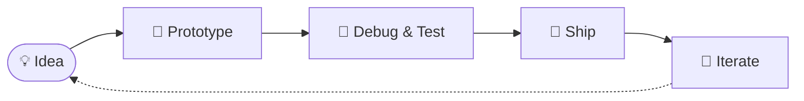

<!--
  GitHub Profile README — Murasoli Balaji
  Repository: https://github.com/murasolib/murasolib

  Design notes
  - One palette: Cyan #06B6D4 → Violet #8B5CF6 → Rose #F43F5E
  - All cards use a transparent background + neutral grey text (#8B949E),
    so everything reads well in BOTH GitHub light and dark mode.
-->

<div align="center">

<!-- ═════════════ HEADER (animated waving gradient) ═════════════ -->


<!-- ═════════════ TYPING TERMINAL ═════════════ -->
<a href="https://github.com/murasolib">
  
</a>

<br/>

<!-- ═════════════ SOCIAL BADGES ═════════════ -->
<a href="https://github.com/murasolib"></a>
<a href="https://www.linkedin.com/in/murasolibalaji"></a>
<a href="mailto:balajimurasoli@gmail.com"></a>


</div>


<!-- ═════════════ ABOUT ═════════════ -->
<div align="center">
  
</div>

<table width="100%">
  <tr>
    <td width="62%" valign="middle">

```js
const murasoli = {
  name: "Murasoli Balaji",
  role: "IT Undergrad @ Kongu Engineering College",
  hometown: "Tiruvannamalai, Tamil Nadu 🇮🇳",
  languages: ["Java", "Python", "C"],
  fullStack: ["React", "Node.js", "Express", "MongoDB", "SQL"],
  exploring: ["Deep Learning", "Voice AI", "GIS Modeling"],
  mission: "Crack campus placements & ship open-source",
  motto: "Code like an artist. Debug like a detective."
};
```

</td>
    <td width="38%" align="center" valign="middle">
      
    </td>
  </tr>
</table>

<div align="center">

> ⚡ *"Code like an artist. Debug like a detective. Ship like an engineer."*

</div>


<!-- ═════════════ TECH STACK ═════════════ -->
<div align="center">
  

  <br/>

  
</div>

<table align="center">
  <tr>
    <td align="center" width="150"><b>💻 Languages</b></td>
    <td></td>
  </tr>
  <tr>
    <td align="center"><b>🌐 Web & Databases</b></td>
    <td></td>
  </tr>
  <tr>
    <td align="center"><b>🤖 AI & Tools</b></td>
    <td></td>
  </tr>
</table>


<!-- ═════════════ FEATURED PROJECTS ═════════════ -->
<div align="center">
  
</div>

<table width="100%">
  <tr>
    <td width="50%" valign="top" align="center">
      
      <h3>🤖 ULTRON — Voice AI Assistant</h3>
      
      
      
      <br/><br/>
      🎙️ Hands-free neural voice interaction &amp; smart replies<br/>
      🖥️ Automated Windows app control &amp; system tasks<br/>
      🧠 Context-aware memory with LLM integration
      <br/><br/>
      <a href="https://github.com/murasolib?tab=repositories">
        
      </a>
    </td>
    <td width="50%" valign="top" align="center">
      
      <h3>🌊 GIS Flood &amp; Dam-Break Simulation</h3>
      
      
      
      <br/><br/>
      🗺️ DEM-based 3D terrain processing<br/>
      💧 Real-time dam-break &amp; flash-flood flow modeling<br/>
      📊 Inundation depth heatmaps &amp; geospatial export
      <br/><br/>
      <a href="https://github.com/murasolib?tab=repositories">
        
      </a>
    </td>
  </tr>
</table>

<!-- ═════════════ HOW I BUILD (Mermaid renders natively on GitHub) ═════════════ -->
<div align="center">

**🛠️ How I Build**

</div>




<!-- ═════════════ STATS ═════════════ -->
<div align="center">
  

  <br/>

  
  

  <br/><br/>

  

  <br/><br/>

  <picture>
    <source media="(prefers-color-scheme: dark)" srcset="https://github-readme-activity-graph.vercel.app/graph?username=murasolib&bg_color=0D1117&color=06B6D4&line=8B5CF6&point=F43F5E&area=true&area_color=8B5CF6&hide_border=true&custom_title=Commit%20Velocity%20%26%20Activity"/>
    <source media="(prefers-color-scheme: light)" srcset="https://github-readme-activity-graph.vercel.app/graph?username=murasolib&bg_color=FFFFFF&color=0891B2&line=7C3AED&point=F43F5E&area=true&area_color=8B5CF6&hide_border=true&custom_title=Commit%20Velocity%20%26%20Activity"/>
    
  </picture>

</div>

<details>
  <summary><b>🏆 Trophy Cabinet (click to expand)</b></summary>
  <br/>
  <div align="center">
    
  </div>
</details>

<!-- ═════════════ CONTRIBUTION SNAKE ═════════════ -->
<div align="center">

<picture>
  <source media="(prefers-color-scheme: dark)" srcset="https://raw.githubusercontent.com/murasolib/murasolib/output/github-contribution-grid-snake-dark.svg"/>
  <source media="(prefers-color-scheme: light)" srcset="https://raw.githubusercontent.com/murasolib/murasolib/output/github-contribution-grid-snake.svg"/>
  
</picture>

</div>


<!-- ═════════════ CONTACT ═════════════ -->
<div align="center">

  

  <br/>

  

  <br/><br/>

  <a href="https://github.com/murasolib"></a>
  <a href="https://www.linkedin.com/in/murasolibalaji"></a>
  <a href="mailto:balajimurasoli@gmail.com"></a>

  <br/><br/>

  

  <!-- ═════════════ FOOTER (animated waving gradient) ═════════════ -->
  

</div>
